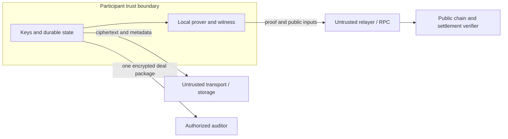

# Erebus Metropolis Threat Model

Status: proposed requirements, 2026-09-14. No EVM security guarantees are verified by this document.
Read the [architecture](metropolis-architecture.md) first.
The existing Starknet deployment retains its [current privacy model](privacy-model.md).

## 1. Assets and adversaries

Protect shielded funds, spend keys, negotiation contents, agreement integrity, and deal-scoped disclosure keys.
Consider a malicious counterparty, relay, relayer, RPC, indexer, prover operator, and public chain observer.
An attacker can bypass the SDK and call contracts directly.
A compromised agent host can read its plaintext and keys. Protocol encryption does not protect that host from itself.

The baseline keeps proof witnesses local. The existing Starknet path exposes pool keys to its
configured proving and preflight endpoints; this draft does not remove that exposure.
Prover placement is a separate decision from whether a circuit exists. Local proving keeps the
witness on the participant host and is the baseline. A remote prover that receives plaintext
witnesses becomes a trusted party and must see no more than the guarantee requires. A
client-side or WASM prover is a later option whose feasibility depends on the proving system,
not on this interface. Alternative backends must declare their trust assumptions and guarantees.
The common interface does not require a prover or assume that a TEE and a private rollup provide equivalent security.

## 2. Visibility targets

These are Architecture C targets, conditional on the selected privacy rail and proof implementation.

| Observer | Visible | Intended hidden |
|---|---|---|
| Public chain reader | Contract, relayer, commitments, nullifiers, roots, timing, transaction shape, public expiry and fees | Negotiation, private payment amount and recipient |
| Public-bound EVM settlement (V1) | Canonical accepted terms, blinding, authorizations, amount, recipient, asset, and timing | Earlier encrypted negotiation messages and rejected offers |
| Deposit/withdrawal observer | Public token transfers, amounts, accounts, timing | Direct mapping to later private notes |
| Transport operator | Endpoints or mailbox identifiers, sizes, timing, availability | Message plaintext |
| Shielded submission RPC | Proof, public inputs, gas payer, query targets and submission metadata | Private witness, spending keys and private agreement fields |
| Artifact host | Requested circuit files/version, download URL, IP, sizes and timing | Local witness, note openings and signing keys |
| Public indexer | Public block cursor, authorization token, IP and request timing | Wallet keys, note openings and private agreement fields |
| Public-bound relayer and RPC | Agreement opening, authorizations and public payment parameters | Spending keys and earlier encrypted negotiation history |
| Counterparty | Its negotiation and agreed terms | Other deals and spending secrets |
| Auditor with one grant | Selected transcript, opening, authorizations, payment evidence | Other deal keys and spending authority |
| Authorized wallet agent / model provider | Note amounts, commitments/nullifiers, asset, reservation/consumption state and account diagnostics returned by enabled tools | Spending keys, note salt and proof witnesses are not returned by the reviewed tools |

Token identity can remain public through pool selection. A small anonymity set can make amount and timing correlations strong.
Removing public channel opening can reduce direct relationship disclosure. Relaying alone does not prove relationship privacy.
An observer can correlate deposits, withdrawals, endpoints, and timing even when ciphertext remains secure.
The older public-bound relayer accepts agreement openings. The separate shielded
candidate accepts only version and proof calldata, under Bearer authentication.
Do not send shielded openings or witnesses through either service.
A separate gas key does not hide network identity or prove that payments are unrelated.
Wallet tool responses can expose private amounts and future spend identifiers to an agent's model provider.
See the [source and test review](metropolis-leakage-review.md) for the tested boundary and remaining logging gaps.

### Diagnostic formatting boundary

Candidate agreement, service, fee-policy, mapped shielded-deal, canonical writer and prepared
settlement objects redact normal and pretty `Debug` output. Explicit encodings, selected disclosure
openings and direct field access still contain sensitive data. Redaction is not encryption and
cannot prevent a caller from logging those bytes deliberately. CLI output and service requests
need separate checks; the formatter regression alone does not close the leakage review.

### Artifact, indexer and local file boundaries

Artifact downloads are public-file GET requests. The installer disables automatic referrers
so redirects do not forward an original URL's query token to the destination. The original
host still sees its complete requested URL. Hashes and publisher checks authenticate files;
they do not hide download metadata or certify setup entropy.

The public indexer accepts only `after` and `limit` query fields and empty request bodies.
Malformed queries and bodies return a plain status, not the rejected input. Body reads are
bounded to one byte and one second. An upstream proxy can still see anything a caller sends;
never put a note opening, witness or key in an indexer request.

Erebus encrypts messages before uploading to the mailbox relay. The relay is an opaque-byte
store, not a validator of encryption: uploading plaintext directly exposes it to the operator.
Bearer authentication gates service access, not each recipient's mailbox permissions.
Anyone with service access and a mailbox ID can retrieve ciphertext; Noise session keys
protect its contents. Mailbox IDs, lengths, timing and endpoints remain visible. Insecure
development mode binds loopback only; empty or whitespace-only tokens are refused.

The note wallet uses encrypted snapshots. The participant transcript store contains message
plaintext in owner-only files; its source explicitly treats those files as sensitive.
Local witness files are also plaintext inputs with restricted permissions. Do not publish,
serve, or upload participant state or witness directories. Owner-only permissions do not
protect against the owning account, root, backups copied elsewhere or a compromised host.

The shared journal rejects existing symlinks and non-regular record, blob and lock entries.
It rejects a symlink at the journal root before changing permissions. New files request
owner-only permissions when opened, before bytes are written. These checks assume trusted
parent directories and a trusted local owner; they do not prevent concurrent path replacement
by that owner. Journal records and transaction blobs are not encrypted by the storage engine.

For paid APIs, repeated per-request settlements can reveal which service an agent uses, how often
it uses it, and activity patterns from which an observer may infer strategy. Prepaid or batched
settlement can reduce onchain frequency but does not hide requests from the service, transport
metadata from network operators, or the timing and size of each published batch.

The candidate prepaid service retains a provider-finalized payment certificate and private
agreement fields in owner-only local state. It serves later calls without new chain reads.
This assumes that the certified anchor remains finalized and the seller's state is intact.
The service sees the buyer agreement key, resource, call count, and request timing.
Its records and response blobs are not encrypted by the metered journal.

Public-tree root checks establish insertion consistency, not complete spend-event history.
Two providers can omit the same spend-only event without changing a Merkle root. A consumed
deal mapping alone cannot certify service payment: the matching canonical settlement log is
also required. Provider observations are not receipt-inclusion proofs or consensus verification.
Dishonest providers, local rollback, or a compromised seller host remain trust assumptions.

## 3. Required attack tests

| Attack | Required defense | Acceptance test |
|---|---|---|
| Guess the hidden price | Fresh random commitment blinding | Dictionary of likely terms cannot reproduce the commitment without its blinding |
| Substitute terms or authorizations | Canonical encoding, role tags, domain binding | Mutate each field and swap roles; verification fails |
| Pay less or redirect payment | Proof binds amount, asset, and recipient to the agreement | Direct contract call with each changed output fails |
| Mint through overflow | Range constraints and per-asset conservation | Boundary, overflow, and mixed-asset witnesses fail |
| Replay a deal with fresh funds | Deterministic authorized deal nullifier | Same agreement with different input notes cannot settle twice |
| Spend a note twice | Pool note nullifiers | Concurrent spends produce at most one successful transition |
| Replay on another chain or deployment | Domain in commitment, authorization, proof, and contract checks | Wrong chain, pool, verifier version, or contract fails |
| Mix valid unrelated proofs | Shared constrained payment commitments | Agreement proof A plus payment proof B fails |
| Downgrade a required guarantee | Requirement-to-backend check before submission | A deal requiring hidden amount cannot select a public settlement backend |
| Steal relayer fees or front-run | Bound fee and recipient policy | Modified fees fail; copied submission cannot redirect value |
| Commit unusable payment ciphertext | Output encryption correctness or recipient acknowledgment | Seller decrypts and can spend every accepted output |
| Forge or reorder messages | Peer authentication, sequence, parent hash, signed final root | Duplicate, forked, cross-session, and missing-parent messages are rejected |
| Settle an expired agreement | Contract time check bound to authorized expiry | Submission after expiry reverts |
| Retry after lost response | Durable operation intent and chain reconciliation | Kill after broadcast; restart without a second payment |
| Fake indexer receipt | Independent chain evidence and finality verification | Fabricated event or orphaned block cannot mark a deal finalized |
| Broaden disclosure | Independent deal keys and recipient encryption | Wrong recipient and adjacent deal remain unreadable |
| Infer agent behavior from paid API traffic | Prepaid or batched settlement where compatible, plus an explicit metadata report | Compare per-request and aggregate public traces; record which service, timing, frequency, and batch information remains inferable |

A dictionary test is a regression check, not a cryptographic proof of commitment hiding.
Failure of one observer attack does not establish anonymity against every observer.

## 4. Authorization and cancellation

An authorization gives bounded payment permission. It does not reserve funds or force a party to submit.
A new counteroffer does not invalidate an earlier signed revision. All revisions share one consumed deal identity under M0 D02.
An offchain cancellation cannot revoke a proof that the chain still accepts.
Until a cancellation mechanism exists, treat signed permission as usable until expiry or settlement.
Do not present local cancellation as onchain revocation.
Signature-based authorization for an EVM backend reveals the signer when recovered. Where the
deal requires hidden parties, authorization must be proven rather than recovered, so a
public-signature V1 and a private V2 differ in the authorization mechanism as well as in the
payment. EIP-712 provides typed signing and no replay protection on its own.

The contract must verify the settlement domain itself. A prover-supplied domain is insufficient.
Verifier upgrades and pool administration affect these guarantees. Document their authority before deployment.

## 5. Disclosure and data availability

Offchain transcripts need durable storage. A commitment cannot reconstruct missing messages.
The disclosure package includes selected messages, their authentication, the agreement opening, both authorizations, and matching settlement evidence.
Encrypt the package to the auditor and authenticate its issuer where issuer identity is claimed.
The auditor verifies the transcript root, commitment opening, authorizations, and payment linkage independently.

A grant must contain neither parent session keys nor spending secrets.
Grant expiry is an application access rule. It cannot erase a decrypted copy or prevent its recipient from sharing plaintext.
Revocation also cannot retract information already disclosed.
An authenticated transcript proves the included statements and their binding, not their truth or completeness outside the agreed root.

## 6. Atomicity and operational limits

Atomicity covers settlement state: deal consumption, input consumption, and output creation succeed together or revert together.
It does not cover delivery of an external API response, dataset, or compute job.
A seller can receive payment and withhold service. Escrow, dispute resolution, and cryptographic fair exchange require separate designs.

RPC and relay failures can delay settlement. A relayer must never need a participant's spending key.
LLM prompts, tool responses, telemetry, and crash logs can leak terms despite correct encryption.
The access SDK/MCP now publishes fixed messages for recognized native error codes; it does
not forward free-form subprocess error text or unknown codes. Undecodable subprocess output
fails with fixed recovery guidance. An undecodable settlement reply is not permission to
submit again. The caller retains the operation ID and observes the chain.

Snapshot result paths must name the configured cache and reported issuance ID. Metered
result paths must stay in the fixed calls directory with the journal's digest-shaped filename.
These are shape/route checks, not new content verification: Rust still owns the receipt,
file and hash checks. Returned hashes, commitments and local paths remain metadata visible
to the agent. A compromised host or substituted binary is not made trustworthy by JSON checks.
Keep secrets out of public demo logs and provide an explicit private operator view.
Use budgets and role permissions at the agent boundary, but enforce payment authorization independently in settlement.

## 7. Evidence required before claims

Record the circuit and verifier versions, dependency revisions, deployed addresses, and all public inputs.
Run the attack tests against direct contract calls as well as SDK calls.
Separate local tests, live testnet evidence, and external review in reports.
Unaudited prototype evidence does not establish production readiness.
Any public-payment fallback must identify exposed amounts and recipients and must not claim Architecture C settlement privacy.
Every backend must report its verified guarantee set, and a demo must state which guarantees
were actually enforced rather than which were intended.

## 8. M5A shielded review findings (2026-10-06; candidate v2 implementation 2026-10-07)

Source: `94aa059` plus the uncommitted candidate v2 working tree on `metropolis`; the full
invariant-to-code-to-test checklist, hashes, and reruns are in the
[status record](metropolis-status.md). This is a design review plus local implementation, not an
audit, and it does not close M5A or M5. The candidate is uncommitted, uses known-entropy test
artifacts, is unaudited, and is not deployed.

- **Identity authorization key (fixed).** `(0,1)` is on-curve and in the prime-order subgroup, so
  the EdDSA check accepted it; with `A` the identity the verification equation reduces to
  `S·Base8 = R8`, making `(R8 = Base8, S = 1)` a publicly computable forgery for any message. The
  circuit already rejected the key (`8A.x ≠ 0`), so on-chain settlement was unaffected, but suite-2
  off-chain verification (`verify_agreement`, access-request authentication, suite-2 disclosure
  grants) accepted forged consent for an agreement that named the identity key. Rust now rejects
  identity at verification and at commitment construction; regression
  `identity_authorization_keys_cannot_authorize_any_agreement`.
- **Circuit EdDSA on-curve checks (addressed in candidate v2; audit scope).** The circomlib
  `EdDSAPoseidonVerifier` constrained `A ≠ 0` and `S < subOrder` but did not check that `A` or `R8`
  lie on BabyJubJub while the Rust path does. Candidate v2 wraps both authorization checks in
  `circuits/m5/lib/eddsa_strict.circom`: on-curve `BabyCheck` for both points, prime-order subgroup
  membership for both, and non-zero `S`, with identity `A` rejected and identity `R8` allowed to
  match Rust. Independent review is still required.
- **Note-domain separation (addressed in candidate v2; narrow claim).** Note commitments and
  nullifiers bound the asset but not chain, pool, or verifier version. Candidate v2 binds
  `noteDomain = Poseidon(chainId, contractAddress, verifierVersion)` into tags 2010/2011 in all
  three circuits and Rust, so identical openings no longer produce identical commitments across
  deployment domains. Timing, funding, withdrawal, gas-payer, and other metadata remain linkable;
  a small anonymity set still permits inference.
- **Under-constrained change tag (addressed in candidate v2; audit scope).** `changeSpendTag` was a
  free nonzero witness in `transfer.circom`. Candidate v2 adds `changeSpendSecret` and constrains
  `changeSpendTag == Poseidon(2006, changeSpendSecret)` plus a non-zero secret, and the wallet
  durably retains the positive change opening with restart and encrypted-backup recovery tests.
- **Key distinctness (addressed in candidate v2 as SDK policy).** Core and circuit permitted equal
  buyer and seller authorization keys. Candidate v2 rejects equal keys in `ShieldedDeal::from_terms`
  as SDK policy; self-deals remain representable at the pool level and a disclosed or SDK-verified
  deal is not proof that two distinct parties exist.
- **Gas-payer linkability (declared, not solved).** Direct submission exposes the buyer's gas account.
  The sponsored candidate uses a sponsor account; installed live sponsorship remains unqualified.
  The circuit fixes fee = 0. Do not send witnesses or invent an unconstrained fee.
  An on-chain user-paid fee requires a reviewed agreement/circuit revision and new setup artifacts.
- **Evidence boundary (unchanged).** The candidate still uses test-only artifacts with known
  entropy; no audit, ceremony, or independent review exists. Passing local suites, AI review, and
  scanners are not an audit.

### M5C lane review and native value (2026-10-06)

- **Signer-lane generalization reviewed.** `SignerJournal` binds the full call (operation
  reference, target, calldata hash, fees, gas, and now value) and `broadcast_call` validates the
  stored bytes against the stored plan. A local journal tamper can no longer redirect a call by
  editing only the record: the persisted target, value, and calldata hash are compared with the
  exact signed transaction, and mismatches fail closed.
- **Reverted attempts are retained.** A finalized canonical revert clears the active signed bytes
  but appends the transaction hash, including block, to a bounded attempt history; a retry is
  therefore distinguishable from the reverted attempt, and the reverted nonce cannot be confused
  with a later one. A completed operation is never rebroadcast.
- **Replacement is same-intent and explicit.** A replacement may change only fee caps: sender,
  nonce, chain, target, value, calldata, and gas limit are preserved and the new transaction is
  validated against the previous one before anything is persisted. Replacements are persisted
  before broadcast, every older attempt hash is reconciled because an older attempt can win, and
  there is no automatic cancellation or new-nonce retry.
- **Native value is explicit.** Only wrap may carry a nonzero value, and it must equal the
  wrapped amount; settlement, approval, deposit, withdrawal, and unwrap require zero. Signed
  plans encode version 2 with the value; version 1 remains readable as zero value and is never
  rewritten as version 1.
- **Effects are verified, not assumed.** Wrap/unwrap completion requires a finalized canonical
  receipt plus the exact sender, target, value, and calldata and exactly one wrapper
  `Deposit`/`Withdrawal` event for the participant with the exact amount. Parent/including block
  balance deltas include unrelated transactions and are supplementary, never the evidence.
  Receipt success alone never completes a wrap or unwrap.
- **Legacy records fail closed.** Pre-expectation records are reconstructed from the durable
  intent (target, selector, note commitment/nullifier, or approval spender) before any receipt is
  accepted. Raw self-consistency alone is insufficient; unreconstructable or mismatching records
  are reported for manual reconciliation and never silently completed or rewritten.
- **Local wrapper fixture only.** `MockWMON` exists for adversarial tests and does not qualify
  Monad's deployed wrapper or any real WMON contract.
